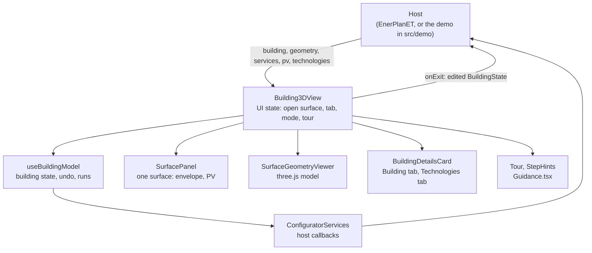

# Architecture

The package's component is `Building3DView` (`src/app/components/workspace/Building3DView.tsx`). A host passes it one building, that building's surface geometry and a set of service callbacks. When the user leaves, the host gets the edited building back through `onExit`. The view never fetches data itself: every request goes through a callback the host supplies.

## Components

The diagram shows how the view is built and which part calls the host.

## Layout

At 1024 px and wider (`WIDE_LAYOUT` in `src/app/lib/useMediaQuery.ts`) the view has three columns. Below that the model sits above the building panel and the surface panel opens as a sheet from the bottom.

| Region | Component | File |
|---|---|---|
| Header: back, building name, Tour, Export, Basic/Expert, Undo | `Building3DView` | `workspace/Building3DView.tsx` |
| Surface panel (left) | `SurfacePanel`, `SurfaceQuickEditor`, `PvSurfaceSection` | `workspace/` |
| Storey panel, replaces the surface panel while storeys are picked | `StoreyPanel` | `workspace/StoreysModelled.tsx` |
| 3D model (centre) | `SurfaceGeometryViewer` | `BuildingConfigurator/configure/surfaces/` |
| Building tab (right) | `LoadProfileBar`, `BuildingSnapshotAside`, `BuildingDetailsCard`, `StoreysModelled`, `BuildingEditor` | `workspace/`, `BuildingConfigurator/overview/`, `BuildingConfigurator/configure/building/` |
| Technologies tab (right) | `TechnologiesTab`, `PvOverview`, `TechnologyCards` | `workspace/` |
| Save & Preview button | `Building3DView` | `workspace/Building3DView.tsx` |
| Tour and step hints | `Tour`, `StepHints` | `workspace/Guidance.tsx` |

Every titled block in the panels is a `SectionCard` (`BuildingConfigurator/shared/SectionCard.tsx`) in the colour of its topic. Topics, their icons and colours are defined once in `src/app/config/topics.ts`.

## State

| State | Owner | Notes |
|---|---|---|
| Building parameters (`general`), surfaces (`elements`), refurbishment | `useBuildingModel` | Seeded from the `building` prop; `toBuildingState` returns them for `onExit` |
| Undo history, unsaved-change flag | `useBuildingModel` | Leaving with unsaved changes asks first |
| TABULA variants and U-values | `useBuildingModel` | Fetched through `fetchMatchingVariants` and `fetchVariantData` |
| Demand totals and load profile | `useBuildingModel` | From the stored `demandProfile`, replaced by the last run |
| Open surface, open tab, Basic/Expert, storey picking, tour | `Building3DView` | Not returned to the host |
| PV surfaces and technologies | Host | Controlled props: the view calls the host's handlers and shows what comes back |

## Service callbacks

`ConfiguratorServices` is defined in `src/app/lib/services.ts`.

| Callback | Called when | Required |
|---|---|---|
| `fetchMatchingVariants` | The view opens, and the type, country or year changes | Yes |
| `fetchVariantData` | Once per refurbishment level that `fetchMatchingVariants` returns | Yes |
| `calculateHeatDemand` | An annual demand estimate is asked for (`estimateHeatDemand`); `Building3DView` does not ask for one | Yes |
| `runBuemBuilding` | Save & Preview | Yes |
| `previewBuemBuilding` | The refurbishment levels are compared by energy class | No |
| `runPvBuilding` | Save & Preview, when the building has PV surfaces | No |

## Data formats

| Concern | File |
|---|---|
| BuEM GeoJSON to and from `BuildingState` | `src/app/lib/buemAdapter.ts` |
| JSON paths for each BuEM schema version | `src/app/config/modelDataMap.ts`, read through `modelDataResolver.ts` |
| The BuEM run request (`toBuem`) | `src/app/lib/buemRun.ts` |
| City2TABULA rows to `BuildingState` | `src/app/lib/city2tabulaAdapter.ts` |
| ignis responses | `src/app/lib/ignisAdapter.ts` |

Schema path changes go in `modelDataMap.ts` only.

`toBuem` sends the building as BuEM is to model it. While storeys are left out, the `building` block holds only the modelled storeys, with each surface cut to its share inside them. In `configurator`, an object BuEM ignores and returns unchanged, the configurator keeps its own keys so the building can be restored in full:

| Key | Holds |
|---|---|
| `construction_year` | The construction year, which BuEM's `construction_period` cannot hold |
| `storeys` | The building's total storey count |
| `storey_list` | One `{ storey, modelled, dwellings?, height? }` entry per storey; `dwellings` and `height` (m) where the user gave them |
| `room_height` | The room height of the storeys without their own, where any storey has its own; `building.h_room` then holds the mean of the modelled storeys' heights |
| `envelope_full` | The envelope of the whole building |
| `residential_units_full` | The dwellings of the whole building, or null |

Buildings stored by 0.14.0 keep `storeys` and `construction_year` beside the block, where they are still read.
